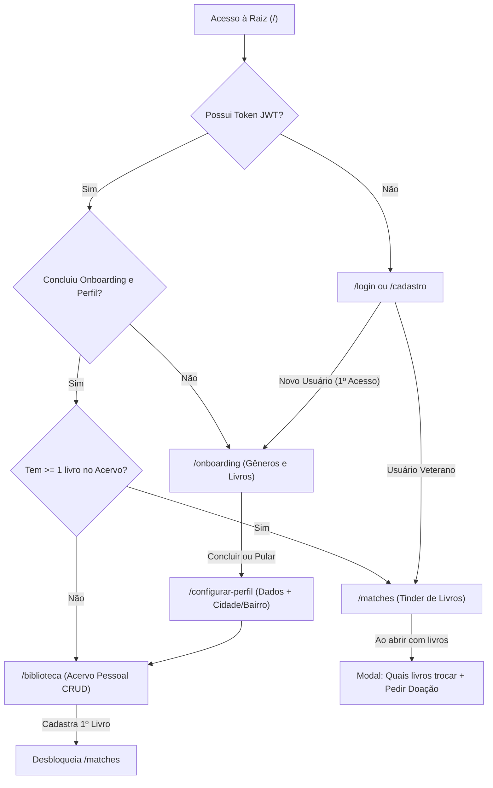

# 📚 BookMatch — Frontend (Comunidade & Tinder de Livros)

O **BookMatch** é uma plataforma social voltada para leitores que combina um **sistema de descoberta estilo "Tinder" (Swipe/Match)** para trocas, empréstimos e doações de livros físicos próximos à localização do usuário com **comunidades literárias, clubes de leitura, acervo pessoal (CRUD) e chat integrado**.

Este repositório contém a aplicação **Frontend (SPA)** pronta para integração com a API Backend REST.

---

## 🚀 Tecnologias Utilizadas

| Categoria | Tecnologia | Versão | Papel na Arquitetura |
| :--- | :--- | :--- | :--- |
| **Core UI** | React + TypeScript | `19.2.x` / `5.9.x` | Componentização tipada e reativa |
| **Build Tool** | Vite | `8.0.x` | Empacotamento rápido e HMR |
| **Estilização** | Tailwind CSS | `4.2.x` | Design System (Light/Dark Mode nativo via tokens CSS) |
| **Roteamento** | React Router DOM | `7.14.x` | Roteamento SPA, guardas de rota (`ProtectedRoute`) e redirecionamentos |
| **Estado Assíncrono** | TanStack React Query | `5.99.x` | Cache de requisições HTTP e sincronização com o servidor |
| **Cliente HTTP** | Axios | `1.15.x` | Instância centralizada com interceptors JWT e tratamento 401 |
| **Formulários & Validação** | React Hook Form + Zod | `7.72.x` / `4.3.x` | Validação de esquemas no cliente (Login, Cadastro, Recuperação) |
| **Ícones** | Lucide React | `1.16.x` | Biblioteca de ícones vetoriais consistente |
| **Linter** | Oxlint | `1.60.x` | Análise estática ultrarrápida para React/TypeScript |

---

## 📂 Estrutura de Pastas (`frontend/src`)

```text
frontend/src/
├── assets/                  # Logos, ilustrações SVG e imagens estáticas
├── components/
│   ├── auth/                # Layout dividido das telas de autenticação (AuthSplitLayout)
│   ├── ui/                  # Componentes base reutilizáveis (Button, Input, Divider)
│   ├── AddBookModal.tsx     # Modal auxiliar de cadastro rápido de livros
│   ├── BookCard.tsx         # Card de exibição de livro com status (Disponível, Emprestado, etc.)
│   ├── EditProfileModal.tsx # Modal de edição completa do perfil (Nome, @user, Email, Tel, Cidade, Bairro)
│   ├── MatchPreferencesModal.tsx # Modal de intenção de troca e lista de desejos por doação
│   └── Navbar.tsx           # Barra de navegação superior responsiva com alternador de tema e perfil
├── hooks/
│   ├── useCurrentUser.ts    # Hook reativo que sincroniza dados do usuário logado e status de 1º acesso
│   └── useTheme.ts          # Gerenciamento de tema Claro/Escuro (persistido em bm_theme)
├── pages/
│   ├── auth/                # LoginPage, RegisterPage e ForgotPasswordPage
│   ├── OnboardingPage.tsx   # Seleção inicial de gêneros e livros favoritos (estilo YouTube Music)
│   ├── AccountSetupPage.tsx # Configuração inicial obrigatória da conta após o Onboarding
│   ├── LibraryPage.tsx      # Acervo Pessoal (CRUD completo: Adicionar, Editar, Excluir, Alterar Status)
│   ├── AddBookPage.tsx      # Tela dedicada de cadastro detalhado de livro físico com fotos e ISBN
│   ├── MatchesPage.tsx      # Tela de Swipe ("Tinder de Livros"), trava de 1º livro e Match Mútuo
│   ├── MessagesPage.tsx     # Chat em tempo real entre leitores com quem houve Match
│   ├── ProfilePage.tsx      # Meu Perfil ("ME") com estatísticas, estante, favoritos e adição rápida
│   ├── ReadersPage.tsx      # Descoberta de leitores próximos por bairro/cidade e afinidade
│   ├── GroupsPage.tsx       # Clubes de leitura, fóruns de discussão e criação de grupos
│   ├── HomePage.tsx         # Feed de exploração de exemplares disponíveis na região
│   └── BookDetailsPage.tsx  # Página de detalhes técnicos, fotos reais e histórico de um livro
├── routes/
│   └── index.tsx            # Definição de todas as rotas, ProtectedRoute e RootRedirect inteligente
├── schemas/
│   └── auth.ts              # Schemas Zod para validação de Login, Cadastro e Recuperação de Senha
└── services/
    ├── api.ts               # Instância Axios configurada com VITE_API_URL e Bearer Token
    ├── auth.ts              # Serviços de autenticação (login, register, forgotPassword)
    └── booksStorage.ts      # Camada de persistência local do acervo e preferências de Match/Doação
```

---

## 🔄 Fluxo de Navegação e Regras de Negócio

A aplicação implementa dois fluxos principais distintos conforme o histórico do usuário:



### Regras de Negócio Implementadas:
1. **Estado Limpo no Primeiro Acesso (`isNewUser`)**:
   - Quando um usuário cria uma conta nova ou entra com o usuário base de primeiro acesso (`novoleitor@bookmatch.com`), seu perfil nasce **100% zerado**: `0 livros`, `0 matches`, `0 seguidores`, **sem conversas no chat**, **sem participar de grupos** e **sem seguir outros leitores**.
2. **Trava de Participação no Match (`/matches`)**:
   - O usuário recém-cadastrado pode navegar livremente por todas as abas (`Explorar`, `Minha Biblioteca`, `Leitores`, `Grupos`, `Mensagens`, `Perfil`), mas **só pode dar swipe/participar do Match após cadastrar pelo menos 1 livro** em seu Acervo Pessoal (`/biblioteca`).
   - Caso acesse `/matches` sem livros cadastrados, é exibida uma tela orientativa com atalho direto para cadastrar seu primeiro exemplar.
3. **Intenção de Troca & Pedido de Doação (`MatchPreferencesModal`)**:
   - Ao abrir a tela de Matches tendo livros no acervo, o sistema pergunta **quais livros do seu acervo você deseja disponibilizar para troca** naquela sessão e oferece a aba **"Pedir Doação"**, onde o leitor pode cadastrar livros que gostaria de receber gratuitamente da comunidade.
4. **Privacidade de Endereço**:
   - Tanto na configuração inicial (`/configurar-perfil`) quanto na edição de perfil (`EditProfileModal`), o endereço é restrito exclusivamente a **Cidade** e **Bairro**, além de Nome, `@username`, E-mail e Telefone/WhatsApp. Nunca são solicitados rua, número ou CEP.

---

## 🗺️ Mapeamento Completo de Rotas e Telas

| Rota | Componente | Protegida? | Descrição da Tela |
| :--- | :--- | :---: | :--- |
| `/` | `RootRedirect` | — | Redireciona automaticamente para `/login`, `/onboarding`, `/configurar-perfil`, `/biblioteca` ou `/matches` dependendo do estado do usuário. |
| `/login` | `LoginPage` | Pública | Autenticação por e-mail/usuário e senha, recuperação de senha e login social (Google, GitHub, LinkedIn). |
| `/cadastro` | `RegisterPage` | Pública | Criação de nova conta com validação de força de senha e aceite de termos. |
| `/recuperar-senha` | `ForgotPasswordPage` | Pública | Disparo de e-mail para redefinição de senha com feedback visual de confirmação. |
| `/onboarding` | `OnboardingPage` | 🔒 Sim | Seleção interativa em 2 etapas: **Gêneros Favoritos** e **Obras Favoritas** (estilo YouTube Music), com opção de pular. |
| `/configurar-perfil` | `AccountSetupPage` | 🔒 Sim | Configuração inicial da conta (Foto, Nome, `@username`, E-mail, Telefone, Bio, Cidade, Bairro e Raio máximo de distância em km). |
| `/biblioteca` | `LibraryPage` | 🔒 Sim | **Acervo Pessoal (CRUD)**: listagem, busca, filtros por status (`Disponível`, `Emprestado`, `Para Doação`), edição inline de exemplar, exclusão e atalho para adicionar livros. |
| `/adicionar-livro` | `AddBookPage` | 🔒 Sim | Formulário completo para cadastrar livro físico (Título, Autor, ISBN, Editora, Ano, Idioma, Páginas, Estado de Conservação, Modalidade Troca/Empréstimo/Doação e Fotos). |
| `/matches` | `MatchesPage` | 🔒 Sim | **Tela de Swipe ("Tinder de Livros")**: cards deslizáveis com 4 ações (`Passar`, `Salvar`, `Trocar`, `Super Match`), modal de Match Mútuo, modal de Preferências de Troca/Doação e histórico de atividade. |
| `/mensagens` | `MessagesPage` | 🔒 Sim | **Tela de Chat**: lista de conversas ativas vinculadas aos livros do Match, envio de mensagens em tempo real, agendamento de ponto de encontro seguro e confirmação de troca. |
| `/perfil` | `ProfilePage` | 🔒 Sim | **Tela "ME" (Meu Perfil)**: dados dinâmicos do usuário logado, modal de edição completa, adição rápida de títulos lidos/favoritos e gerenciamento de estante. |
| `/leitores` | `ReadersPage` | 🔒 Sim | Descoberta de outros leitores por bairro/cidade, percentual de compatibilidade literária, busca e botão de seguir/conversar. |
| `/grupos` | `GroupsPage` | 🔒 Sim | Comunidades e clubes de leitura com abas "Meus Grupos" e "Descobrir", leitura atual do clube, criação de novos grupos e mural de tópicos. |
| `/home` | `HomePage` | 🔒 Sim | Catálogo exploratório de livros disponíveis perto do usuário com filtros por modalidade (`Todos`, `Troca`, `Empréstimo`, `Doação`) e busca. |
| `/livro/:id` | `BookDetailsPage` | 🔒 Sim | Visualização detalhada de um exemplar específico, galeria de fotos do estado físico, dados do dono e botão de propor troca/empréstimo. |

---

## 🔌 Guia de Integração com o Backend

A camada de rede já está estruturada em `src/services/api.ts` e `src/services/auth.ts`.

### 1. Variáveis de Ambiente (`.env`)
Crie um arquivo `.env` na pasta `frontend/` baseado no `.env.example`:

```env
VITE_API_URL=http://localhost:3000/api
```

### 2. Autenticação & Interceptor JWT (`src/services/api.ts`)
- O cliente Axios lê automaticamente `localStorage.getItem('bm_token')` e injeta o header:
  ```http
  Authorization: Bearer <token>
  ```
- Caso o backend retorne `HTTP 401 Unauthorized` em qualquer rota autenticada (exceto `/auth/*`), o interceptor limpa a sessão local e redireciona o usuário para `/login`.

### 3. Contratos de Endpoints Esperados pelo Frontend

#### **Autenticação (`src/services/auth.ts`)**
- `POST /auth/login`
  - **Request**: `{ "email": "string", "password": "string", "remember": boolean }`
  - **Response**: `{ "token": "jwt_string", "user": { "id": "string", "name": "string", "username": "string", "email": "string", "phone": "string", "city": "string", "neighborhood": "string", "bio": "string", "avatarUrl": "string", "onboardingCompleted": boolean, "accountSetupCompleted": boolean } }`
- `POST /auth/register`
  - **Request**: `{ "name": "string", "email": "string", "password": "string" }`
  - **Response**: `{ "token": "jwt_string", "user": { ... } }`
- `POST /auth/forgot-password`
  - **Request**: `{ "email": "string" }`
  - **Response**: `{ "message": "string" }`

#### **Perfil e Onboarding**
- `PUT /users/me/onboarding`
  - **Request**: `{ "favoriteGenres": ["string"], "favoriteBooks": ["string"] }`
- `PUT /users/me/profile`
  - **Request**: `{ "name": "string", "username": "string", "email": "string", "phone": "string", "bio": "string", "city": "string", "neighborhood": "string", "maxDistance": number, "avatarUrl"?: "string" }`

#### **Acervo Pessoal de Livros (`src/services/booksStorage.ts` $\rightarrow$ API)**
- `GET /books/me` — Lista os livros cadastrados pelo usuário logado.
- `POST /books` — Cadastra um novo exemplar físico (`title`, `author`, `genre`, `condition`, `status`, `modality`, `isbn`, `synopsis`, `coverUrl`).
- `PUT /books/:id` — Atualiza dados ou status do exemplar (`Disponível`, `Emprestado`, `Indisponível`).
- `DELETE /books/:id` — Remove exemplar do acervo.

#### **Matches, Trocas e Pedidos de Doação**
- `PUT /matches/preferences` — Salva quais IDs de livros do acervo estão marcados para troca (`tradeBookIds: string[]`).
- `GET /donations/wishlist` & `POST /donations/wishlist` — Lista e cadastra livros que o usuário gostaria de receber por doação (`title`, `author`, `reason`).
- `GET /matches/Queue` — Retorna a fila de cards de livros próximos para swipe.
- `POST /matches/swipe` — Registra a ação do swipe (`bookId`, `action: 'skip' | 'save' | 'like' | 'superlike'`).

---

## 🛠️ Como Executar o Projeto Localmente

### Pré-requisitos
- **Node.js** `>= 20.x` (recomendado `v22` ou `v24`)
- **npm** `>= 10.x`

### Passo a Passo

```bash
# 1. Acesse a pasta do frontend
cd frontend

# 2. Instale as dependências
npm install

# 3. Inicie o servidor de desenvolvimento
npm run dev
```

A aplicação estará disponível em `http://localhost:5173`.

### Scripts Disponíveis
- `npm run dev` — Inicia o servidor Vite em modo de desenvolvimento com HMR.
- `npm run build` — Executa a checagem de tipos do TypeScript (`tsc -b`) e gera o bundle de produção na pasta `dist/`.
- `npm run lint` — Executa o linter `oxlint` em todo o código-fonte.
- `npm run preview` — Serve localmente a build de produção gerada.

---

## 🧪 Usuários Base para Testes (Homologação / Sprint 1)

Para testar os dois fluxos principais na tela de Login (`/login`), utilize as seguintes credenciais base:

| Perfil de Teste | E-mail / Login | Senha | Comportamento Esperado |
| :--- | :--- | :--- | :--- |
| **1º Acesso (Novo Usuário)** | `novoleitor@bookmatch.com` | `senha123` | Inicia com perfil `"Usuário Teste"` **100% limpo** (sem livros, sem amigos, sem grupos e sem chats). Redireciona para `/onboarding` (pesquisa de gêneros e livros) $\rightarrow$ `/configurar-perfil` (nome, `@usuario`, e-mail, telefone, cidade e bairro) $\rightarrow$ `/biblioteca` (acervo pessoal). Bloqueia o swipe em `/matches` até que o 1º livro seja cadastrado. |
| **Usuário Veterano (Já Configurado)** | `leitor@bookmatch.com` | `password123` | Simula um leitor ativo (`"Paulo Leitor"`) que já possui acervo cadastrado, matches, conversas no chat e grupos. Abre diretamente na tela de **Matches (`/matches`)**. |

