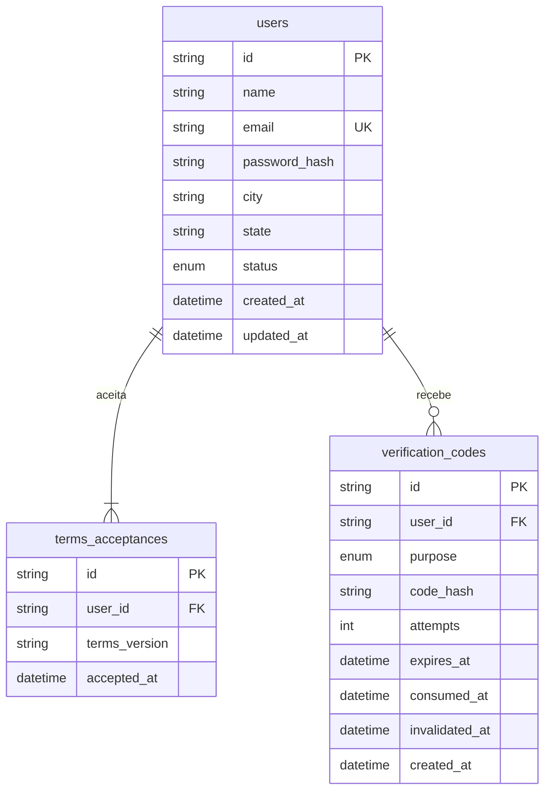

# Modelos de tabelas

Tabelas do cadastro de usuário com verificação de e-mail por código de 6
dígitos. O schema fica em `backend/prisma/schema.prisma`.

## Relações



- Um usuário tem **pelo menos um** aceite de termos: o cadastro cria o usuário
  e o aceite na mesma transação.
- Um usuário tem **zero ou mais** códigos de verificação: cada envio ou
  reenvio gera um código novo.

## Convenções

- Modelos e campos em inglês, como o restante do código.
- Tabelas e colunas em snake_case, via `@@map` e `@map`.
- IDs UUID v7 em `Char(36)`, gerados pela aplicação (`IdGenerator`), sem
  `@default` no banco.
- Datas de criação e de eventos vêm da aplicação (`Clock`), sem
  `@default(now())`.

## Schema

```prisma
enum UserStatus {
  PENDING_VERIFICATION
  ACTIVE
}

enum VerificationPurpose {
  EMAIL_VERIFICATION
  PASSWORD_RESET
}

model User {
  id           String     @id @db.Char(36)
  name         String     @db.VarChar(100)
  email        String     @unique @db.VarChar(254)
  passwordHash String     @map("password_hash") @db.VarChar(255)
  city         String     @db.VarChar(100)
  state        String     @db.Char(2)
  status       UserStatus
  createdAt    DateTime   @map("created_at") @db.DateTime(3)
  updatedAt    DateTime   @updatedAt @map("updated_at") @db.DateTime(3)

  termsAcceptances  TermsAcceptance[]
  verificationCodes VerificationCode[]

  @@map("users")
}

model TermsAcceptance {
  id           String   @id @db.Char(36)
  userId       String   @map("user_id") @db.Char(36)
  termsVersion String   @map("terms_version") @db.VarChar(20)
  acceptedAt   DateTime @map("accepted_at") @db.DateTime(3)

  user User @relation(fields: [userId], references: [id])

  @@unique([userId, termsVersion])
  @@map("terms_acceptances")
}

model VerificationCode {
  id            String              @id @db.Char(36)
  userId        String              @map("user_id") @db.Char(36)
  purpose       VerificationPurpose
  codeHash      String              @map("code_hash") @db.Char(64)
  attempts      Int                 @default(0)
  expiresAt     DateTime            @map("expires_at") @db.DateTime(3)
  consumedAt    DateTime?           @map("consumed_at") @db.DateTime(3)
  invalidatedAt DateTime?           @map("invalidated_at") @db.DateTime(3)
  createdAt     DateTime            @map("created_at") @db.DateTime(3)

  user User @relation(fields: [userId], references: [id], onDelete: Cascade)

  @@index([userId, purpose, createdAt])
  @@map("verification_codes")
}
```

## Tabelas

### `users`

| Coluna | Tipo | Observação |
|---|---|---|
| `id` | `CHAR(36)` | UUID v7 |
| `name` | `VARCHAR(100)` | |
| `email` | `VARCHAR(254)` | Único. Salvo em minúsculas e sem espaços |
| `password_hash` | `VARCHAR(255)` | Só o hash. A senha nunca é salva em texto puro |
| `city` | `VARCHAR(100)` | |
| `state` | `CHAR(2)` | Sigla da UF |
| `status` | enum | Ver [estados do usuário](#estados-do-usuário) |
| `created_at` | `DATETIME(3)` | |
| `updated_at` | `DATETIME(3)` | Atualizado pelo Prisma |

### `terms_acceptances`

Registra qual versão dos termos de uso e da política de privacidade cada
usuário aceitou e quando. O checkbox obrigatório garante o aceite; esta
tabela é a prova dele.

| Coluna | Tipo | Observação |
|---|---|---|
| `id` | `CHAR(36)` | UUID v7 |
| `user_id` | `CHAR(36)` | FK para `users` |
| `terms_version` | `VARCHAR(20)` | Versão aceita |
| `accepted_at` | `DATETIME(3)` | |

- Cada usuário aceita cada versão uma única vez (`user_id` + `terms_version`
  únicos).
- Quando os termos mudarem, o novo aceite gera uma nova linha e o histórico é
  preservado.
- A relação impede excluir um usuário que tenha aceites. O tratamento da
  exclusão de conta fica para a spec dessa funcionalidade.

### `verification_codes`

Códigos de 6 dígitos de uso único. O campo `purpose` permite reaproveitar a
tabela na recuperação de senha.

| Coluna | Tipo | Observação |
|---|---|---|
| `id` | `CHAR(36)` | UUID v7 |
| `user_id` | `CHAR(36)` | FK para `users`. Apagado junto com o usuário |
| `purpose` | enum | `EMAIL_VERIFICATION` ou `PASSWORD_RESET` |
| `code_hash` | `CHAR(64)` | HMAC-SHA-256 do código com chave secreta do servidor |
| `attempts` | `INT` | Tentativas erradas |
| `expires_at` | `DATETIME(3)` | Fim da validade |
| `consumed_at` | `DATETIME(3)` | Preenchido quando o código é usado com sucesso |
| `invalidated_at` | `DATETIME(3)` | Preenchido quando um reenvio gera outro código |
| `created_at` | `DATETIME(3)` | Usado para contar os reenvios por período |

- O código nunca é salvo em texto puro. Com 6 dígitos há só 1 milhão de
  combinações; o HMAC impede testar todas sem a chave do servidor.
- O índice `(user_id, purpose, created_at)` permite contar os envios recentes
  sem tabela de contadores.

## Estados

### Estados do usuário

```text
          cadastro
             │
             ▼
  ┌──────────────────────┐   código correto   ┌────────┐
  │ PENDING_VERIFICATION │ ─────────────────▶ │ ACTIVE │
  └──────────────────────┘                    └────────┘
   não consegue fazer login                    faz login
```

### Estados do código de verificação

O estado do código não é uma coluna: ele é calculado a partir das datas e das
tentativas. A expiração depende do relógio, então uma coluna de status
precisaria de um processo para marcar os códigos vencidos.

```text
                    ┌─▶ CONSUMIDO    consumed_at preenchido
                    │
  ATIVO ────────────┼─▶ INVALIDADO   invalidated_at preenchido
  (recém-criado)    │
                    ├─▶ EXPIRADO     agora > expires_at
                    │
                    └─▶ BLOQUEADO    attempts no limite
```

Um código só é aceito quando está **ativo**: não consumido, não invalidado,
dentro da validade, abaixo do limite de tentativas e com o hash
correspondente ao valor informado.
